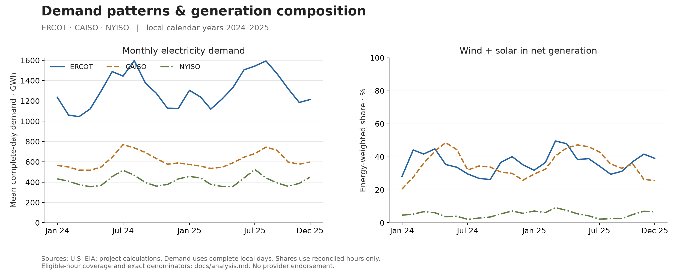

# Energy Demand & Generation Lakehouse

[](https://github.com/receperecek/energy-demand-weather-lakehouse/actions/workflows/ci.yml)

A Databricks data platform for understanding electricity demand patterns and generation composition across ERCOT, CAISO and NYISO. It combines EIA hourly electricity data with NASA POWER weather proxies, then publishes tested analytical tables and an AI/BI dashboard.

The project connects an engineering question—**can revised, incomplete external data be processed repeatedly without misleading consumers?**—with an analytical question—**how do demand schedules and generation composition differ by region and season?**



The validated historical run processes **529,000 electricity records** and **158,112 weather records** into **52,704 unique region-hour observations**. ERCOT's complete-day demand is 463.78 TWh in 2024 and 488.05 TWh in 2025; eligible wind + solar shares rise across all three regions. NYISO has five invalid demand hours, which remain visible and prevent three affected local days from being treated as complete. Read the [analytical findings and exact denominators](docs/analysis.md) and [release validation](docs/validation-evidence.md).

## Scope

- Historical analysis: local calendar years 2024–2025, three balancing authorities.
- Electricity: hourly demand, total net generation and reported fuel categories.
- Weather context: temperature, 10 m wind and hourly radiation; three equal-weight city grid proxies per region.
- Incremental operation: bounded revision lookback, explicit historical backfills and source replay.
- Exploration: seasonal demand, weekday/weekend schedules, generation composition, descriptive weather relationships and a quality-aware investigation queue.

Forecasting and causal claims are outside v1. A high-demand candidate is an exploratory flag, not a grid reliability prediction.

## Platform

| Layer | Technology | Responsibility |
|---|---|---|
| Acquisition | Python standard library, EIA/NASA APIs | UTC contracts, pagination, request budgets, safe retries and sanitized immutable snapshots |
| Storage/governance | Unity Catalog, managed Volume, Delta Lake | Source hashes, lineage, controlled project schema and secret scope |
| Transformation | PySpark, bounded Delta MERGE | Normalization, invalid-record quarantine, source revisions and replay |
| Analytical modeling | dbt-databricks, SQL warehouse | Hourly/local-day/fuel marts, grain and aggregate reconciliation tests |
| Orchestration | Databricks Jobs, Declarative Automation Bundles | Reproducible four-task workflow, explicit date parameters and serialized execution |
| Consumption | Immutable releases, active pointer, AI/BI dashboard | Stable views of the latest successfully tested results |
| Repository checks | pytest, GitHub Actions | Offline contracts, pinned Actions, read-only CI and credential/history checks |

See [architecture](docs/architecture.md) for the data flow and failure boundaries, [metric contracts](docs/metrics.md) for units and denominators, and [operations](docs/runbook.md) for deployment and recovery.

## Repository

```text
src/energy_platform/   Source clients, normalization, snapshot storage and Delta operations
notebooks/            Databricks tasks and isolated cloud integration checks
dbt/                  SQL models, region dimension and data tests
dashboards/           Portable AI/BI dashboard definition
scripts/              Dashboard definition generator and repository secret scanner
tests/                Offline source/security/normalization contracts
docs/                 Architecture, metrics, source usage, operations and release evidence
```

## Reproduce

Run offline tests with Python 3.11+:

```powershell
python -m venv .venv
.\.venv\Scripts\python.exe -m pip install -e '.[dev]'
.\.venv\Scripts\python.exe -m pytest
```

Cloud execution requires an authorized Databricks workspace, Unity Catalog, serverless Jobs, a SQL warehouse and an EIA key stored in Databricks Secrets. NASA POWER needs no key. Follow the [runbook](docs/runbook.md) to create the schema/Volume, configure the secret, validate the bundle and run a backfill. The schedule starts paused; deployment does not silently enable recurring compute.

The dashboard's catalog/schema/warehouse are bundle variables; its dataset SQL uses stable publication views. It is deployed into the owner's workspace and does not embed the deployment identity's credentials for viewers. A clone can deploy its own dashboard; public GitHub access does not grant access to the original workspace.

## Reliability and analytical limits

Complete API pagination, a manifest written only after acquisition finishes, grain checks and measured coverage protect different failure modes. Known-key invalid revisions replace earlier measurements as invalid. Signed storage generation is preserved. Local-day totals require the expected 23/24/25 valid hours. Wind + solar shares use energy-weighted denominators and source reconciliation; coverage accompanies the results.

The weather proxy is not a comprehensive load- or asset-weighted regional measure. NASA meteorology and solar grids have different resolutions, and source data can be revised. A short incremental lookback cannot capture every older revision; periodic longer backfills are necessary. Intermediate tables are not an atomic multi-table transaction, so consumers read publication views rather than candidates.

## Sources, licensing and security

Source: [U.S. Energy Information Administration](https://www.eia.gov/opendata/) and [NASA POWER](https://power.larc.nasa.gov/). Derived metrics, aggregations and quality flags are project calculations. No provider endorsement is implied. See [sources and usage](docs/sources-and-usage.md) for policies, parameter details, attribution and request limits.

Original project code is [MIT licensed](LICENSE). Provider data remain subject to their own policies. Credentials, raw dumps, OAuth caches and workspace deployment state are excluded. See [SECURITY.md](SECURITY.md) for boundaries and exposure handling. No source credential is required by GitHub CI.
