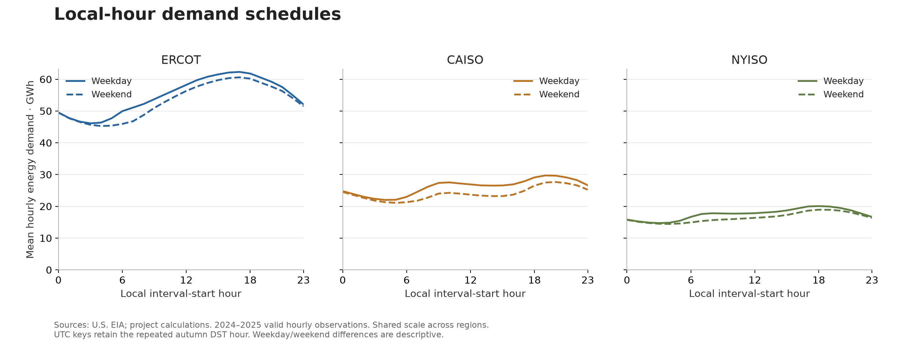
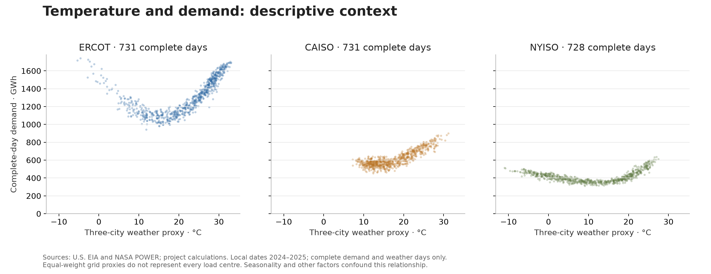

# Demand patterns and generation composition

Historical scope: local calendar years **2024–2025**, ERCOT (`ERCO`), CAISO (`CISO`) and NYISO (`NYIS`). Sources: U.S. EIA and NASA POWER, retrieved on 2026-10-07; derived metrics and figures are project calculations. Aggregate export: 2026-10-07 02:33 UTC. This is descriptive analysis of balancing-authority reports, not state retail electricity consumption or a grid reliability forecast.

## What the evidence shows

ERCOT's complete-day demand totals increase from **463.78 TWh in 2024 to 488.05 TWh in 2025**, approximately 5.2%. CAISO is approximately **224.03 TWh in both years**. Annual totals are calendar-year volumes, including 2024's extra leap day; these comparisons do not attribute changes to weather, population, or economic growth. NYISO's totals below exclude three incomplete local days across the two years and should not be treated as complete annual demand.

The regions have different local-hour schedules. Across the two-year weekday profile, the highest mean hourly demand starts at **17:00 in ERCOT**, **19:00 in CAISO**, and **18:00 in NYISO**. These are interval-start hours and averages across valid weekday observations, rather than the hour of a single extreme event. The absolute scale also differs substantially across the balancing authorities.

Eligible energy-weighted pure wind + solar shares increase between 2024 and 2025 in all three regions: approximately **34.4% → 37.4% for ERCOT**, **34.0% → 37.2% for CAISO**, and **4.6% → 5.3% for NYISO**. NYISO's lower wind + solar share is not a statement about all renewable generation: reported hydro is a substantial separate category. These denominators include only reconciled eligible hours; ERCOT's 2025 coverage is 97.24%, so its reported share does not describe every hour.

## Annual measures and denominators

| Authority | Year | Complete demand days / calendar days | Complete-day demand (TWh) | Wind + solar share | Share-eligible local hours |
|---|---:|---:|---:|---:|---:|
| ERCOT | 2024 | 366 / 366 | 463.781 | 34.43% | 99.31% |
| ERCOT | 2025 | 365 / 365 | 488.052 | 37.43% | 97.24% |
| CAISO | 2024 | 366 / 366 | 224.029 | 33.99% | 99.70% |
| CAISO | 2025 | 365 / 365 | 224.024 | 37.19% | 99.79% |
| NYISO | 2024 | 364 / 366 | 150.090 | 4.64% | 99.72% |
| NYISO | 2025 | 364 / 365 | 151.120 | 5.32% | 99.85% |

The source-backed [annual query and rows](evidence/annual_summary.json) retain exact values. Demand is the sum of complete local-day MWh, converted to TWh. Wind + solar share is the sum of eligible `SUN + WND` MWh divided by eligible total net generation, not an average of hourly percentages. SUN and WND must both be reported and valid. Total fuel generation must reconcile with region-reported net generation within max(1 MWh, 1%). Hybrid categories remain separate.

## Seasonality and hourly schedules

The highest monthly mean complete-day demand in the reviewed window is **1,597.5 GWh in August 2024 for ERCOT**, **769.0 GWh in July 2024 for CAISO**, and **524.8 GWh in July 2025 for NYISO**. The corresponding two-year minima are 1,044.7 GWh in March 2024, 517.1 GWh in April 2024, and 355.3 GWh in April 2024. Monthly means reflect the complete days available in each month; they are not monthly total energy.

The weekday maxima average **62.31 GWh in ERCOT** (523 valid observations at hour 17), **29.71 GWh in CAISO** (523 at hour 19), and **20.08 GWh in NYISO** (521 at hour 18). The repeated autumn clock-change hour remains two separate UTC observations. Profile curves pool seasons and both years; they are suitable for comparing schedules but do not establish a fixed future peak-hour rule. Inspect [monthly rows](evidence/monthly_demand.json) and [hour-profile rows](evidence/hour_profile.json) for all periods and sample counts.

## Reported fuel composition

Natural gas is the largest observed fuel category over the two-year local-date window in all three authorities. ERCOT's next-largest categories are wind and coal; CAISO's are solar and hydro; NYISO's are nuclear and hydro. The comparison uses signed valid reported generation, with category-specific hour counts. It does not infer absent categories as zero or adjust incomplete fuel coverage into full-year estimates. See the [fuel rows and query](evidence/fuel_mix.json).

Negative generation is retained: net consumption can occur in storage and other reported generation categories. Negative records are a review signal, not automatically an invalid measurement. The dashboard exposes signed totals, reported hours and negative-hour counts. Source fuel composition and eligible wind + solar shares have different inclusion rules and should not be treated as interchangeable percentages.

## Weather context

These points compare complete daily demand with the daily mean of a three-city, equal-weight NASA POWER grid proxy. There are 731 complete points for ERCOT, 731 for CAISO and 728 for NYISO. ERCOT and NYISO display higher demand at both cold and hot ends of their observed temperature ranges; the within-region shape is more informative than one cross-region linear correlation. No regression, causal temperature effect, uncertainty interval or forecast is claimed.

Weather is not population-, load-, or asset-weighted. Grid-cell values are not measurements from exact city weather stations. The charts pool seasons, weekdays and years; seasonality, activity and other factors can confound the relationship. Wind at 10 m and radiation remain contextual platform variables rather than renewable-output predictors in this release.

## Quality findings and verification

The full UTC collection has **529,000 Silver energy records** and **158,112 weather records**, drawn from 149 sanitized source snapshots. The published hourly mart has **52,704 rows and exactly 52,704 distinct region-hour keys**. The extra UTC day completes the end of the 2025 local calendar year; plotted/annual results use only the stated local-date scope. All twelve spring/autumn region-day checks confirm expected **23/25-hour days** with complete demand.

| Authority | UTC 2024–2025 expected hours | Valid demand hours | Complete three-point weather hours | Share-eligible hours |
|---|---:|---:|---:|---:|
| ERCOT | 17,544 | 17,544 | 17,544 | 17,241 |
| CAISO | 17,544 | 17,544 | 17,544 | 17,500 |
| NYISO | 17,544 | 17,539 | 17,544 | 17,506 |

This table uses UTC calendar dates, while the annual table uses local dates; boundary offsets explain small differences in eligible-hour totals. NYISO has **five nonpositive demand records** and **48 missing/invalid fuel values**. These 53 records are retained as invalid and quarantined. Five demand hours affect three local dates; complete-day totals for those dates remain null. Complete API pagination does not imply complete source coverage.

Fuel reconciliation also excludes otherwise observed hours. The largest absolute fuel/total gaps in UTC 2024–2025 are 5,634 MWh for ERCOT, 2,271 MWh for CAISO and 3,038 MWh for NYISO; the source discrepancy is preserved for review rather than repaired by balancing an invented fuel category.

Evidence: [UTC quality](evidence/quality_summary.json), [Silver counts](evidence/source_quality.json), [rejection reasons](evidence/quarantine_summary.json), [hourly grain](evidence/grain_check.json), and [DST checks](evidence/dst_contract.json). The [validation record](validation-evidence.md) distinguishes offline, cloud, source and display checks.

## Reproduction and interpretation

Run the pipeline and aggregate exporter described in the [runbook](runbook.md), then render the Python figures. Export metadata identify one immutable active publication; the exporter rejects results if the pointer changes during reading. The committed evidence contains attributed aggregate rows, not API response dumps or credentials. Provider revisions can change later historical exports.

Use this release to inspect demand schedules, seasonal differences, reported generation categories and source-quality exceptions. Predicting demand, estimating causal effects, evaluating grid adequacy, or forecasting blackouts requires a different model and additional evidence.
