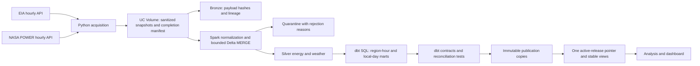

# Architecture

## Storage contracts

The common hourly key is a UTC **interval start**. EIA reports hour-ending labels and is shifted back one hour during normalization. NASA POWER reports interval starts. Source request boundaries are adjusted correspondingly, including the first and last hour of each monthly EIA window. See the official timing references in [source usage](sources-and-usage.md).

All ingestion windows are half-open UTC dates: `[start_date, end_date)`. The APIs' inclusive end parameters are converted explicitly. EIA windows are monthly, paginated with a stable three-column sort; NASA windows are yearly with an exact expected-hour key set. A manifest is written only after both source collections finish. Partial acquisition leaves reusable snapshots but cannot advance Silver.

Raw snapshots contain a SHA-256 of the sanitized payload, window and retrieval time. Sanitization removes credential fields and the EIA request echo. This is an intentionally sanitized source archive, not a byte-for-byte HTTP response archive. Bronze stores those payloads with lineage. Silver validates timestamp, units, region, parameter category, numerical finiteness and physical bounds. Invalid records remain inspectable in quarantine. A known-key measurement that becomes invalid replaces its previous valid value; stale observations cannot masquerade as current valid data.

Silver energy grain: `(source, region_code, hour_utc, metric_code)`. Silver weather grain: `(region_code, location_id, hour_utc, weather_model)`. Conflicting simultaneous observations fail. The most recently acquired observation wins within a complete collection. A complete bounded re-fetch is authoritative: missing keys are deleted only inside its requested window. This prevents old source revisions from persisting after an observation is removed. Complete pagination is still not a substitute for coverage checks.

## Orchestration and publication

The Databricks job serializes acquisition → Silver → dbt seed/build/tests → publication. `max_concurrent_runs=1` prevents competing window updates. Serverless notebooks use the project's Python source; the dbt task runs through a SQL warehouse. The bundle deploys to the current user's home path and takes catalog/schema/warehouse as variables.

Gold candidates are rebuilt from current Silver. They are not the dashboard interface. After dbt tests pass, publication appends a new immutable release for each Gold table and switches one Delta pointer. All consumer views select that pointer. Failed model/test tasks do not publish; failed copying leaves the previous pointer active. Every publication attempt gets a fresh UUID even when the ingestion is retried. This is atomic selection of completed table copies, not a multi-table Delta transaction.

The ingestion manifest ID, Silver lineage, pipeline run log and publication ID support traceability. Snapshot replay and explicit date parameters support backfills. The default incremental window is 14 days ending seven days before today's UTC date to accommodate NASA radiation latency. NASA can revise meteorology after two to three months: run an explicit 90-day reconciliation backfill monthly if long-lag revisions matter. A 14-day job alone cannot capture every older revision.

## Deliberate limits

This is a bounded batch system. It is not streaming, a demand forecasting service or a production grid-control system. Intermediate layers can change during a failed job; consumers use only published views. Released copies consume additional storage; after confirming a release, retain the active release and any versions required for audit, then remove older copies under a separate maintenance process. An incremental update and dashboard publication cover the entire available analytical history, not just the new slice.
